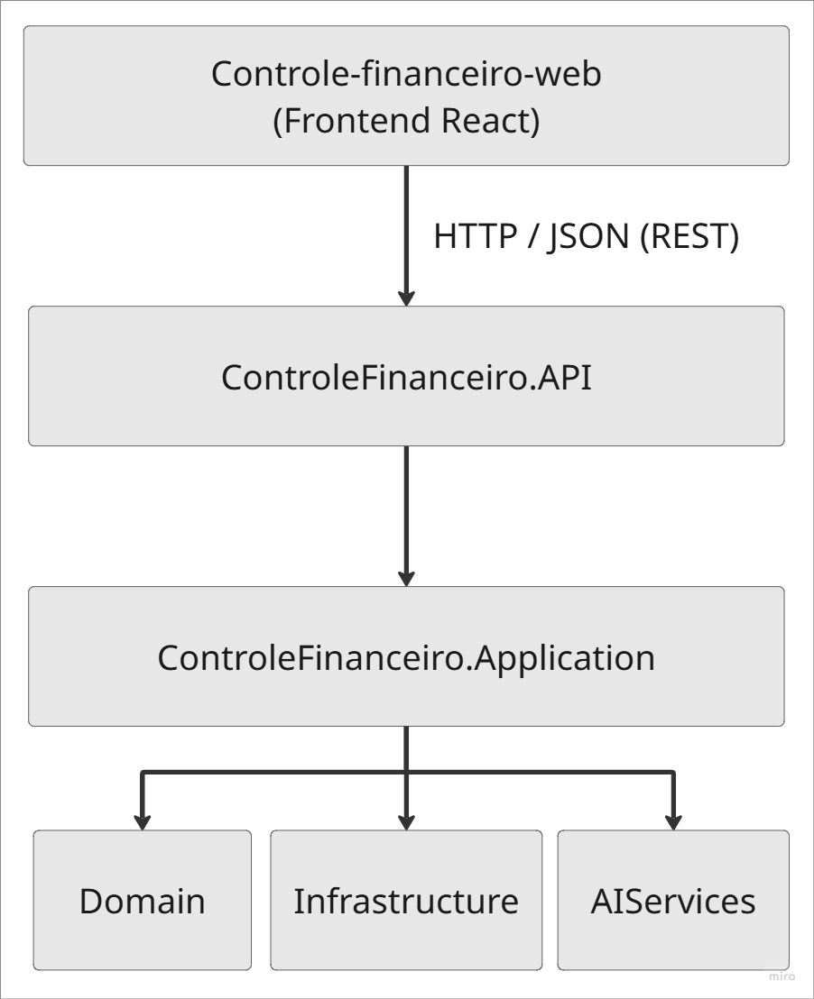
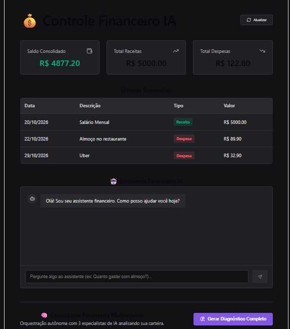
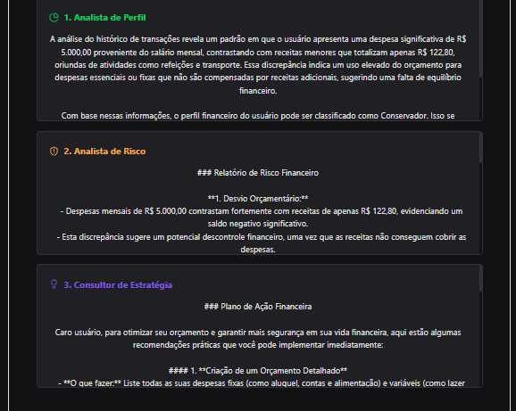

# 💰 Controle Financeiro Pessoal com IA Autônoma

Solução full-stack desenvolvida em **.NET 8 (C# 12)** sob os princípios da **Clean Architecture** e **React 18 + Vite**, integrada à **OpenAI SDK** para oferecer um ecossistema completo de gestão financeira multi-contas com recursos avançados de **Visão Computacional (OCR)**, **Busca Vetorial (Embeddings / RAG)**, **Execução de Ações Autônomas (Tool Calling)** e **Orquestração Multiagentes**.

---

## 📌 Sumário
1. [Visão Geral de Negócio](#-visão-geral-de-negócio)
2. [Arquitetura e Tecnologias](#-arquitetura-e-tecnologias)
3. [Módulos do Sistema & Progresso](#-módulos-do-sistema--progresso)
4. [Recursos de Inteligência Artificial](#-recursos-de-inteligência-artificial)
5. [Catálogo de Endpoints REST](#-catálogo-de-endpoints-rest)
6. [Configuração do Ambiente e Execução](#-configuração-do-ambiente-e-execução)
7. [Interface Visual](#-interface-visual)

---

## 🏢 Visão Geral de Negócio

O sistema resolve a complexidade no acompanhamento financeiro pessoal, substituindo o preenchimento manual e passivo por uma experiência guiada por Inteligência Artificial autônoma e conciliação bancária precisa.

### Principais Benefícios:
* **Gestão Multi-Contas & Projeção de Liquidez:** Controle separado entre Contas Correntes, Contas de Investimento e Cartões de Crédito (com catálogo oficial de bancos brasileiros COMPE), diferenciando saldo compensado de saldo projetado por data de corte.
* **Extrato Individual com Saldo Linha a Linha:** Painel dedicado por conta/cartão com separação entre lançamentos compensados (`DataCompensacao`) e previstos, cálculo acumulado linha a linha (`Ordem`), edição via modal e proteção contra compensação acidental em datas futuras.
* **Entrada de Dados Sem Fricção:** Leitura automática de comprovantes físicos (cupons fiscais, recibos, notas) via IA generativa visual, extraindo dados sem necessidade de digitação.
* **Assistente Conversacional RAG:** Consultas em linguagem natural sobre o histórico de movimentações, calculando gastos e agregando valores em tempo real.
* **Agente de Ação (Tool Calling):** Capaz de interpretar comandos operacionais (ex: *"Lance um almoço de R$ 45,50 na conta Itaú"*) e invocar as regras do sistema de forma segura.
* **Rede Multiagente de Análise:** Três agentes especializados que colaboram sequencialmente para classificar o perfil do usuário, auditar riscos de endividamento e prescrever recomendações financeiras personalizadas.

---

## 🛠 Arquitetura e Tecnologias

A solução é estruturada em camadas estritas baseadas em **Clean Architecture** no backend e SPA modularizada em **React** no frontend, garantindo testabilidade, baixo acoplamento e independência de infraestrutura.

<p align="center">
  
</p>

### Stack Tecnológica:
* **Backend:** .NET 8 / C# 12 (Minimal APIs + Services)
* **Banco de Dados:** SQL Server / LocalDB via Entity Framework Core 8
* **Frontend:** React 18 + Vite (`controle-financeiro-web`) + Lucide Icons
* **Documentação & Testes:** Swagger / OpenAPI UI
* **Integração de IA:** SDK Oficial da OpenAI (`OpenAI.Chat` / `OpenAI.Embeddings`)
* **Modelos Utilizados:** `gpt-4o` / `gpt-4o-mini` e `text-embedding-3-small`

---

## 🧩 Módulos do Sistema & Progresso

### 🟢 Módulo 1 — Domínio e Infraestrutura Base (Concluído ✅)
* Configuração de SQL Server/LocalDB, Git, Azure Boards e solução .NET 8 com Clean Architecture.
* Modelagem das entidades `Conta`, `Categoria` e `Transacao` com isolamento seguro de tipos (`TipoTransacao`) e relacionamentos 1:N.
* Laboratório de tokenização e vetorização com Tiktoken (`Microsoft.ML.Tokenizers`).

### 🟢 Módulo 2 — Persistência e Mapeamento (Concluído ✅)
* Mapeamento relacional com Entity Framework Core 8, Fluent API no `AppDbContext` e Migrations.
* Injeção de Dependências nativa (`Microsoft.Extensions.DependencyInjection`) configurada no `Program.cs`.
* Padrão Repository e Service Layer com metadados de IA (`ConfiancaIA`).

### 🟢 Módulo 3 — Visão Computacional e Embeddings (Concluído ✅)
* **OCR com GPT-Vision:** Leitura de imagens de comprovantes em formato Base64/arquivo, extraindo automaticamente `Valor`, `Data`, `Estabelecimento` e `Sugestão de Categoria`.
* **Motor de Embeddings:** Vetorização de descrições financeiras e busca por similaridade de cosseno (Cosine Similarity) para categorização semântica.

### 🟢 Módulo 4 — Assistente RAG, Agentes Autônomos & Interface Web (Concluído ✅)
* **RAG Chat (`IFinancialChatService`):** Recuperação do contexto financeiro no banco relacional para alimentar os prompts da OpenAI com dados reais e atualizados do usuário.
* **Tool Calling (`IToolCallingService`):** Mapeamento dinâmico de métodos C# como ferramentas (`ChatTool`), permitindo que o LLM execute ações operacionais no backend.
* **Pipeline Multiagente Autônomo (`IMultiAgentOrchestratorService`):** Orquestração sequencial encadeada unindo **ClassifierAgent**, **AuditRiskAgent** e **AdvisorAgent**.
* **Frontend Web (`controle-financeiro-web`):** Dashboard consolidado, Chat interativo via RAG e Painel de Consultoria Multiagente.

### 🟡 Módulo 5 — Multi-Contas, Conciliação de Extratos & IA Multimodal (Em Andamento 🔄)
* ✅ **Feature 264 (US 265 a US 267) — Bancos, Multi-Contas e Novo Dashboard:** Tabela de bancos brasileiros (COMPE), suporte a `ContaCorrente`, `ContaInvestimento` e `CartaoCredito`, categorias neutras (`Transferência` e `Pagamento de Fatura`), sugestão automática de nome de conta e Dashboard de liquidez real com projeção de saldo futuro por data de corte.
* 🔄 **Feature 268 (US 269 ✅ | US 270 e US 271 🔲) — Extrato Individual, Reordenação e Transferências:**
  * ✅ **US 269:** Painel individual por conta separando lançamentos compensados (`DataCompensacao`) e previstos, cálculo de saldo acumulado linha a linha (`Ordem`), lançamento rápido, edição completa via modal (com confirmação contra compensação acidental em data futura) e exclusão.
  * 🔲 **US 270:** Reordenação manual de lançamentos compensados via Drag-and-Drop (`Ordem`) para espelhar fielmente o extrato bancário.
  * 🔲 **US 271:** Operações pareadas de transferência entre contas e pagamento de fatura de cartão (`TransferenciaGrupoId`).
* 🔲 **Feature 272 (US 273 a US 275) — Conciliação Semi-Automática, Aprendizado de Nomes e Voz/Foto no Chat:** Dicionário inteligente de renomeação de compras (marketplaces), motor de conciliação de extratos/faturas via CSV, Excel e GPT-Vision, e registro rápido de despesas no Assistente Financeiro por texto, áudio (Whisper) e imagem.

### 🔲 Módulo 6 — Análise Preditiva & AWS Cloud Strategy (Próxima Fase)
* 🔲 Projeção avançada de fluxo de caixa e detecção de anomalias de consumo.
* 🔲 Estratégia de arquitetura em nuvem AWS (Amazon Bedrock, governança, privacidade e ROI).
* 🔲 Pipeline CI/CD automatizado e observabilidade das execuções da IA.

---

## 🤖 Recursos de Inteligência Artificial

### 1. RAG (Retrieval-Augmented Generation)
Combina a capacidade de raciocínio do LLM com o contexto relacional do usuário. O serviço `FinancialChatService` busca as transações filtradas por data/conta e injeta o histórico consolidado na chamada ao GPT.

### 2. Tool Calling (Function Calling)
O `ToolRegistryService` expõe os métodos de negócio para a IA em formato JSON Schema:
* `CriarTransacao`: Registra novas movimentações financeiras no banco.
* `ConsultarContasESaldos`: Obtém a lista atualizada de contas e saldos.

O `ToolCallingService` orquestra o loop de execução:
1. Envia a solicitação do usuário e as `ChatTools` registradas.
2. Intercepta quando o LLM solicita a execução de uma ferramenta (`FinishReason.ToolCalls`).
3. Executa a função C# no backend e devolve o resultado para o LLM gerar a resposta final formatada ao usuário.

### 3. Pipeline Multiagentes (Chaining) — Concluído ✅
Fluxo de colaboração sequencial entre três agentes autônomos especializados:

```text
[SQL Server] ──► [MultiAgentOrchestrator] ──► [ClassifierAgent] ──► [AuditRiskAgent] ──► [AdvisorAgent] ──► [Resultado Consolidado]
```

1. **`ClassifierAgent`:** Analisa as receitas e despesas filtradas e classifica o perfil financeiro do usuário (ex: Conservador, Moderado, Agressivo).
2. **`AuditRiskAgent`:** Consome as transações e o perfil atribuído pelo classificador para auditar riscos (endividamento, concentração de gastos, ausência de reserva de emergência).
3. **`AdvisorAgent`:** Avalia as saídas dos dois agentes anteriores para elaborar um plano de ação estratégico com recomendações práticas.

---

## 🌐 Catálogo de Endpoints REST

### Bancos e Categorias (`/api/bancos`, `/api/categorias`)
* `GET /api/bancos?filtro=...` — Lista os bancos brasileiros (COMPE) cadastrados, com suporte a filtro.
* `GET /api/categorias` — Lista todas as categorias financeiras e neutras disponíveis.

### Contas (`/api/contas`)
* `GET /api/contas?incluirInativas=false` — Lista as contas correntes, de investimento e cartões de crédito.
* `GET /api/contas/resumo-dashboard?dataCorte=YYYY-MM-DD` — Retorna a liquidez atual, faturas de cartão e saldos projetados até a data de corte.
* `GET /api/contas/{id}/extrato` — Retorna o extrato individual da conta separado em lançamentos compensados (com saldo acumulado linha a linha) e previstos.
* `POST /api/contas` — Cadastra uma nova conta bancária ou cartão de crédito.
* `PUT /api/contas/{id}` — Atualiza os dados de uma conta existente.
* `PATCH /api/contas/{id}/status?ativa=...` — Ativa ou inativa uma conta.

### Transações (`/api/transacoes`)
* `GET /api/transacoes` — Lista o histórico geral de transações registradas.
* `POST /api/transacoes` — Registra uma nova transação financeira (compensada ou prevista).
* `PUT /api/transacoes/{id}` — Edita dados, datas ou situação de compensação de uma transação.
* `DELETE /api/transacoes/{id}` — Exclui uma transação.
* `POST /api/Transacoes/ocr` — Processa a imagem de um comprovante fiscal e extrai os dados via GPT-Vision.

### Assistente e Agentes IA (`/api/Chat`)
* `POST /api/Chat/perguntar` — Consulta o assistente RAG sobre o histórico financeiro em linguagem natural.
* `POST /api/Chat/acao` — Envia comandos em linguagem natural para execução de ações reais via Tool Calling.
* `POST /api/Chat/analise-multiagente` — Dispara o pipeline autônomo dos três agentes de IA (Classificador, Auditoria e Consultor) para análise financeira completa.

---

## ⚙️ Configuração do Ambiente e Execução

### Pré-requisitos
* **.NET 8 SDK** instalado.
* **Visual Studio 2022 / Community Edition** (com carga de trabalho de Desenvolvimento Web).
* **Node.js 18+** instalado (para o frontend React).
* **SQL Server** ativo (ou LocalDB).
* Chave de API ativa da **OpenAI**.

### Passo a Passo

1. **Clonar o Repositório:**
   ```bash
   git clone https://github.com/eduardowke/controle-financeiro.git
   cd controle-financeiro
   ```

2. **Configurar a Chave da OpenAI:**
   Adicione sua chave no arquivo `src/ControleFinanceiro.API/appsettings.json`:
   ```json
   {
     "ConnectionStrings": {
       "DefaultConnection": "Server=(localdb)\\mssqllocaldb;Database=ControleFinanceiroDb;Trusted_Connection=True;"
     },
     "OpenAI": {
       "ApiKey": "SUA_CHAVE_OPENAI_AQUI"
     }
   }
   ```
   *(Ou utilize o User Secrets do .NET em ambiente de desenvolvimento):*
   ```bash
   dotnet user-secrets set "OpenAI:ApiKey" "SUA_CHAVE_OPENAI" --project src/ControleFinanceiro.API
   ```

3. **Executar as Migrations do Banco de Dados:**
   ```bash
   dotnet ef database update --project src/ControleFinanceiro.Infrastructure --startup-project src/ControleFinanceiro.API
   ```

4. **Iniciar o Backend (.NET 8 API):**
   ```bash
   dotnet run --project src/ControleFinanceiro.API
   ```
   *(Ou abra `controle-financeiro-ia.sln` no Visual Studio 2022, defina `ControleFinanceiro.API` como projeto de inicialização e pressione `F5` para abrir o Swagger UI).*

5. **Iniciar o Frontend (React + Vite):**
   Em um segundo terminal:
   ```bash
   cd controle-financeiro-web
   npm install
   npm run dev
   ```
   *(Acesse no navegador o endereço local exibido pelo Vite, geralmente `http://localhost:5173`).*

---

## 📸 Interface Visual (Dashboard & Agentes de IA)

<p align="center">
  
</p>

<p align="center">
  
</p>